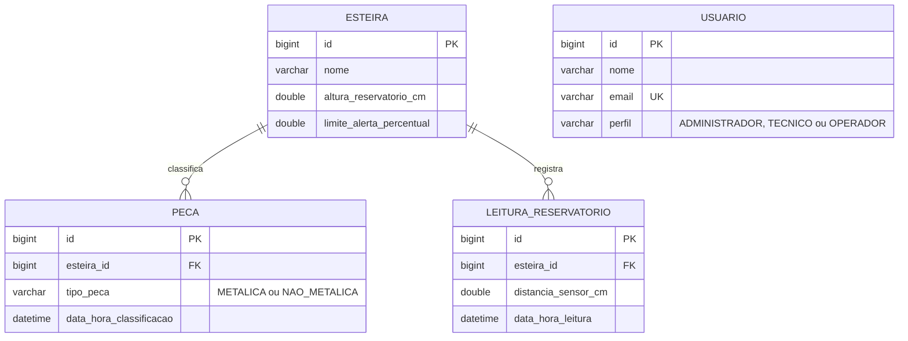

# Modelo de banco de dados – MetalTech

SGBD: **MySQL 8.0.16+** · Banco: `metaltech` · Scripts na pasta `banco_de_dados/`.

## Diagrama entidade-relacionamento

`USUARIO` não se relaciona com as demais tabelas: ele só controla quem acessa a plataforma.

## Dicionário de dados
| Tabela | Coluna | Tipo | Regra |
|---|---|---|---|
| esteira | id | BIGINT | PK, auto incremento |
| | nome | VARCHAR(255) | obrigatório |
| | altura_reservatorio_cm | DOUBLE | obrigatório, > 0 |
| | limite_alerta_percentual | DOUBLE | obrigatório, entre 1 e 100 |
| peca | id | BIGINT | PK |
| | esteira_id | BIGINT | FK → esteira, `ON DELETE CASCADE` |
| | tipo_peca | VARCHAR(31) | `METALICA` ou `NAO_METALICA` (coluna discriminadora da herança `Peca`) |
| | data_hora_classificacao | DATETIME(6) | obrigatório |
| leitura_reservatorio | id | BIGINT | PK |
| | esteira_id | BIGINT | FK → esteira, `ON DELETE CASCADE` |
| | distancia_sensor_cm | DOUBLE | obrigatório, ≥ 0 |
| | data_hora_leitura | DATETIME(6) | obrigatório |
| usuario | id | BIGINT | PK |
| | nome | VARCHAR(255) | obrigatório |
| | email | VARCHAR(255) | obrigatório, **único** |
| | perfil | VARCHAR(20) | `ADMINISTRADOR`, `TECNICO` ou `OPERADOR` |

## Normalização
**1ª Forma Normal (1FN)** – Todas as colunas guardam um único valor (nada de listas ou
campos compostos), cada tabela tem chave primária e não há grupos repetidos. As leituras e as
peças são linhas separadas, não colunas como `leitura1`, `leitura2`.

**2ª Forma Normal (2FN)** – Todas as chaves primárias têm uma única coluna (`id`), então
não existe dependência parcial. Cada coluna depende da chave inteira.

**3ª Forma Normal (3FN)** – Nenhuma coluna não-chave depende de outra coluna não-chave:
- `altura_reservatorio_cm` e `limite_alerta_percentual` ficam em `esteira`, e não repetidos em
  cada leitura. Alterar uma regra da esteira é um único `UPDATE`.
- **A ocupação (%) não é gravada.** Ela é derivada de `distancia_sensor_cm` (da leitura) e de
  `altura_reservatorio_cm` (da esteira). Gravar o valor criaria uma dependência transitiva e o
  risco de ficar inconsistente se a altura mudasse. Por isso ela é calculada na view
  `vw_leitura_ocupacao` e no método `getOcupacaoPercentual()` do back-end.
- Os totais por tipo de peça também não são gravados: saem de `COUNT` sobre `peca`
  (view `vw_resumo_esteira`).
- `tipo_peca` depende apenas da peça. As subclasses `PecaMetalica` e `PecaNaoMetalica` não
  têm atributos próprios, então a tabela única não gera colunas nulas. Se no futuro cada tipo
  ganhar atributos específicos, trocar para `InheritanceType.JOINED`.

## Integridade e segurança dos dados
- Chaves estrangeiras com `ON DELETE CASCADE`: excluir uma esteira remove suas peças e leituras.
- `CHECK` impede valores impossíveis (altura ≤ 0, distância negativa, tipo ou perfil inválido).
- `email` único: a API devolve `409` se houver tentativa de repetir.
- Índices em `(esteira_id, data_hora)` aceleram o histórico e as séries temporais da Ciência de Dados.
- Para a equipe de Nuvem: crie um usuário do banco só para a API, com permissão de
  `SELECT, INSERT, UPDATE, DELETE` no schema `metaltech`, em vez de usar o `root`.

## Como usar
1. `mysql -u root -p < banco_de_dados/01_criar_banco.sql` (cria banco, tabelas e views)
2. `mysql -u root -p < banco_de_dados/02_dados_exemplo.sql` (opcional: 1 esteira, 3 usuários, 103 peças, 120 leituras)
3. `03_consultas_uteis.sql` traz consultas prontas para a Ciência de Dados (proporção por tipo,
   estatística descritiva, série temporal, anomalias).
4. No `application.properties`, com o banco já criado pelo script, troque
   `spring.jpa.hibernate.ddl-auto=update` por `validate`. Assim o Hibernate só confere se as
   classes batem com as tabelas, sem alterar nada.
